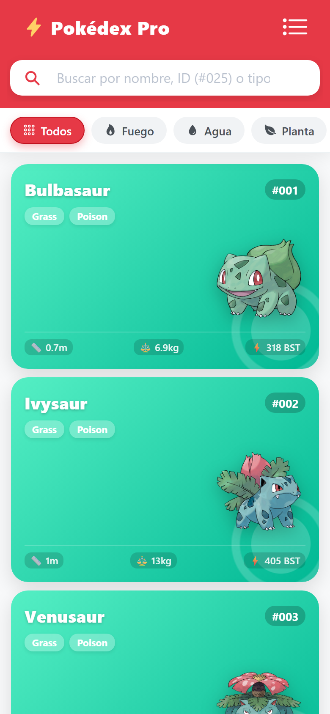
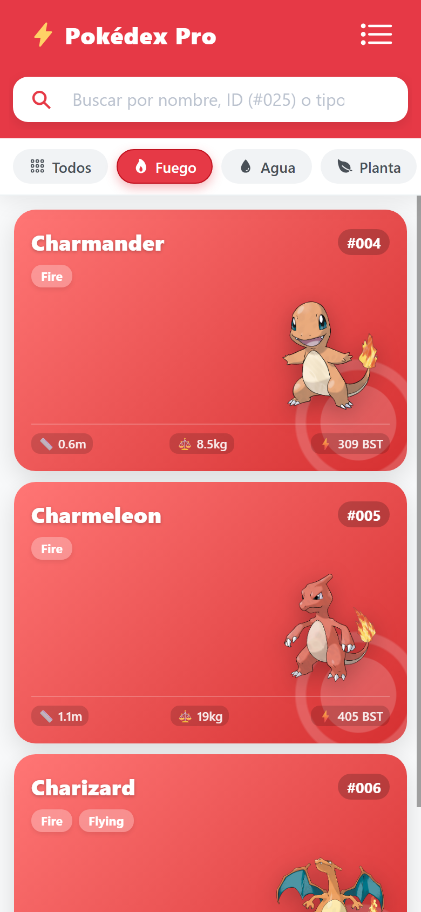
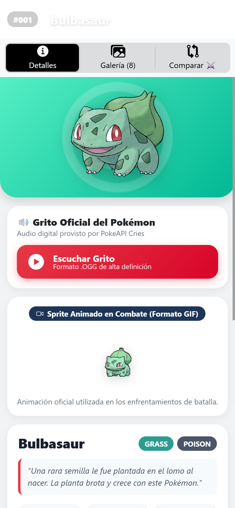
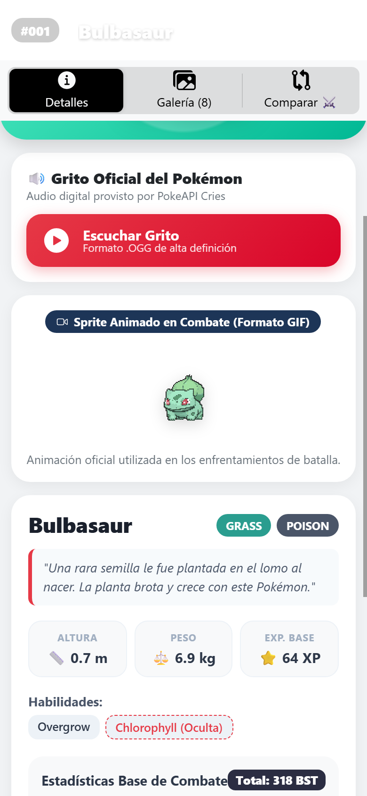
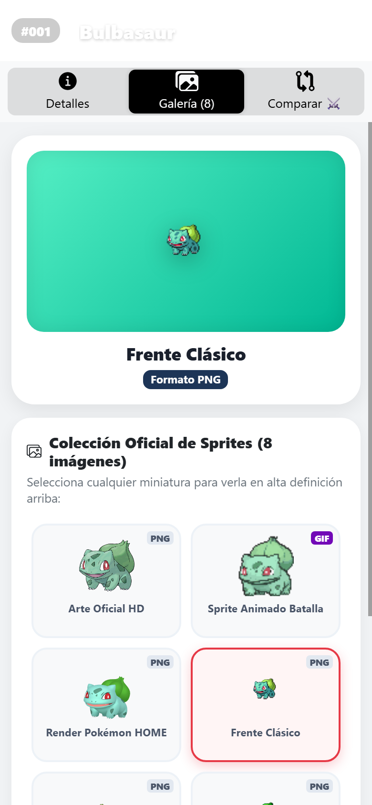
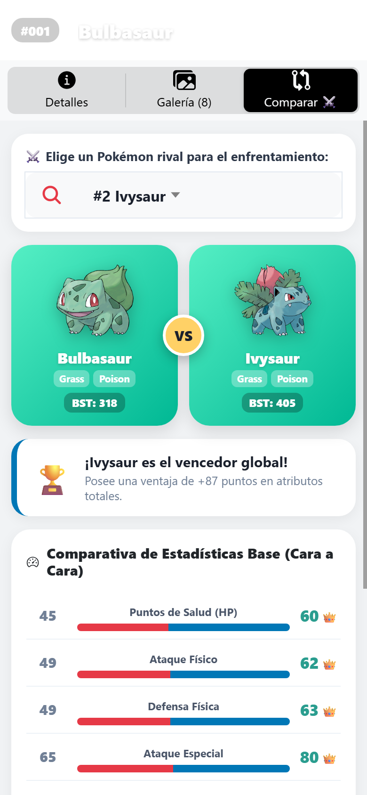
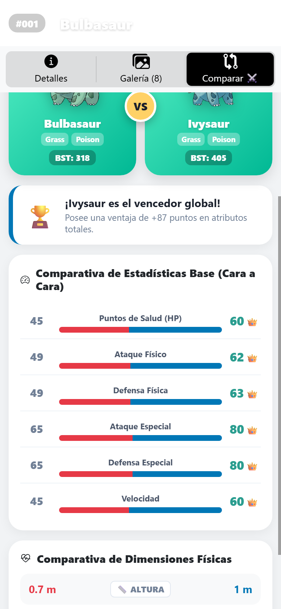

# Pokédex Pro - Aplicación Móvil (Ionic + Angular + PokeAPI)

Aplicación móvil desarrollada con **Ionic Framework**, **Angular** y **Capacitor** que consume la API REST de [PokeAPI](https://pokeapi.co/) para ofrecer una experiencia completa de exploración, multimedia y combate Pokémon, organizada en tres niveles de complejidad según los requerimientos del laboratorio.

---

## 👨‍💻 Información del Proyecto
- **Asignatura**: Desarrollo de Aplicaciones Móviles
- **Autor**: Alex Barba
- **Framework**: Ionic 8 / Angular 18+ / Capacitor 6
- **Fuente de Datos**: [PokeAPI v2](https://pokeapi.co/) & [PokeAPI Cries](https://github.com/PokeAPI/cries)

---

## 🎯 Objetivos y Niveles Implementados

### 🟢 Nivel 1: Buscador y Detalles Visuales
- **Buscador en tiempo real**: Permite filtrar Pokémon por nombre (ej. *Pikachu*, *Charizard*), por número de Pokédex (#025, #006) o por tipo elemental.
- **Búsqueda remota inteligente**: Si el usuario escribe el nombre o ID de un Pokémon que no esté en la lista inicial, la aplicación consulta automáticamente PokeAPI y lo incorpora dinámicamente.
- **Filtro de categorías por Chips**: Barra horizontal deslizable con accesos rápidos para filtrar por tipo elemental (Todos, Fuego, Agua, Planta, Eléctrico, Psíquico, Hielo, Dragón, Fantasma, etc.).
- **Ficha técnica completa**: Visualización de altura, peso, habilidades (con distinción de habilidad oculta), experiencia base y descripción de especie en español.
- **Estadísticas de combate**: Barras de progreso dinámicas con codificación de colores según el nivel de poder para PS (HP), Ataque, Defensa, Atq. Especial, Def. Especial y Velocidad, junto al cálculo del Poder Total (BST).
- **Diseño visual agradable**: Tarjetas modernas estilo Pokédex con degradados dinámicos según el tipo principal del Pokémon, marca de agua de Pokéball translúcida, efectos de elevación y alternador de vista Cuadrícula / Lista.

### 🟡 Nivel 2: Sonido, Galería y Multimedia (GIF / WebP)
- **Reproductor de sonido (Grito Pokémon / Cry)**: Reproduce el grito característico del Pokémon utilizando los registros oficiales de audio digital `.ogg` de PokeAPI (`cries.latest`). Incluye botón interactivo con cambio de estado ("Escuchar Grito" / "Reproduciendo...") y ondas de ecualizador animadas.
- **Galería oficial de más de 5 imágenes**: Colección de hasta 8 sprites y renders oficiales por cada Pokémon:
  1. *Arte Oficial HD* (Ilustración principal de alta resolución).
  2. *Sprite Frente Clásico*.
  3. *Sprite Espalda Clásico*.
  4. *Sprite Frente Shiny ✨* (Versión variocolor).
  5. *Sprite Espalda Shiny ✨* (Versión variocolor).
  6. *Render 3D Pokémon HOME* (Modelo 3D moderno).
  7. *Ilustración Dream World* (Estilo artístico alternativo).
  8. *Sprite Animado de Batalla Showdown* (GIF oficial).
- **Visor interactivo de galería**: Al tocar cualquier miniatura, se proyecta en grande en el visor superior con su etiqueta y badge identificador de formato (`PNG`, `GIF`, `WEBP`, `SVG`) y estado Shiny.
- **Visor destacado de Sprite Animado (GIF)**: Tarjeta dedicada en los detalles que exhibe el sprite animado en bucle oficial de los combates Pokémon en formato GIF.

### 🔴 Nivel 3: Comparador de 2 Personajes (Arena 1 vs 1)
- **Selector interactivo de contrincante**: Menú desplegable para elegir a cualquier Pokémon disponible como rival para el enfrentamiento.
- **Arena de combate Versus (VS)**: Presentación estética lado a lado con ambos contrincantes, sus tipos elementales, insignias de poder total (BST) y emblema central VS.
- **Banner de veredicto global**: Determina automáticamente al vencedor del duelo calculando la diferencia numérica exacta de puntos de combate o declarando empate técnico.
- **Comparativa estadística cara a cara**: Evaluación detallada atributo por atributo (HP, Ataque, Defensa, Atq. Esp., Def. Esp., Velocidad) con asignación de la corona de victoria 👑 al vencedor de cada categoría y barras de balance proporcional en tiempo real.
- **Comparativa de dimensiones físicas**: Contraste directo de altura (m) y peso (kg) entre ambos Pokémon.

---

## 📱 Capturas de Pantalla de la Aplicación en Ejecución

### 1. Pantalla Principal y Catálogo Pokédex (Nivel 1)
Cuadrícula responsiva de tarjetas modernas con degradados según el tipo elemental, número de Pokédex y marca de agua Pokéball.

<p align="center">
  
</p>

---

### 2. Buscador y Filtro por Tipo Elemental (Nivel 1)
Filtrado instantáneo mediante la barra de búsqueda y selector horizontal de chips de tipos (ejemplo: filtro de tipo *Fuego* activo).

<p align="center">
  
</p>

---

### 3. Modal de Detalles y Estadísticas Base (Nivel 1)
Ficha técnica del Pokémon con su ilustración oficial HD, dimensiones, habilidades, descripción y barras de combate coloreadas.

<p align="center">
  
</p>

---

### 4. Reproductor de Sonido (Grito) y Sprite Animado GIF (Nivel 2)
Botón de audio interactivo con ecualizador de ondas sonoras para escuchar el grito del Pokémon y visor del GIF animado oficial de batalla.

<p align="center">
  
</p>

---

### 5. Galería Multimedia de Sprites Oficiales (Nivel 2)
Colección interactiva con visor ampliado de sprites normales, de espaldas, versiones Shiny ✨ variocolor, renders HOME y Dream World.

<p align="center">
  
</p>

---

### 6. Arena de Combate y Comparador 1 vs 1 (Nivel 3)
Enfrentamiento cara a cara entre dos Pokémon con selector de rival, emblema VS y banner de veredicto con cálculo de ventaja global.

<p align="center">
  
</p>

---

### 7. Comparativa Estadística Detallada Atributo por Atributo (Nivel 3)
Barras de balance proporcional por cada estadística (Salud, Ataque, Defensa, Velocidad) y coronas 👑 en los valores ganadores.

<p align="center">
  
</p>

---

## 📂 Estructura del Proyecto

```text
PokeApp/
├── android/                         # Proyecto nativo para compilación en Android Studio
├── screenshots/                     # Capturas de pantalla organizadas por nivel
│   ├── 01_nivel1_pokedex_grid.png
│   ├── 02_nivel1_filtro_buscador.png
│   ├── 03_nivel1_detalles_estadisticas.png
│   ├── 04_nivel2_reproductor_grito_gif.png
│   ├── 05_nivel2_galeria_multimedia.png
│   ├── 06_nivel3_comparador_arena_vs.png
│   └── 07_nivel3_comparador_estadisticas.png
├── src/
│   ├── app/
│   │   ├── pages/
│   │   │   └── pokemon-list/        # Vista principal (Buscador, Modal, Galería y Comparador)
│   │   │       ├── pokemon-list.page.html
│   │   │       ├── pokemon-list.page.scss
│   │   │       ├── pokemon-list.page.ts
│   │   │       └── pokemon-list.module.ts
│   │   ├── services/
│   │   │   └── pokemon.service.ts   # Conexión con PokeAPI (detalles, listas, especies, gritos)
│   │   ├── app-routing.module.ts
│   │   ├── app.component.ts
│   │   └── app.module.ts
│   ├── theme/
│   │   └── variables.scss           # Paleta de colores temáticos de Pokémon
│   ├── global.scss                  # Animaciones (flotación, brillo shiny, ondas de audio)
│   └── index.html
├── capacitor.config.ts              # Configuración de Capacitor para empaquetado móvil
├── ionic.config.json
├── package.json
└── README.md
```

---

## 🌐 Endpoints de PokeAPI Utilizados

| Recurso | Endpoint | Propósito |
| :--- | :--- | :--- |
| **Lista General** | `GET /api/v2/pokemon?limit=30&offset=0` | Obtener listado de Pokémon iniciales. |
| **Detalle Completo** | `GET /api/v2/pokemon/{nombre_o_id}` | Tipos, estadísticas base, altura, peso, habilidades y sprites. |
| **Especie / Texto** | `GET /api/v2/pokemon-species/{id}` | Descripción en español (flavor text), género y hábitat. |
| **Grito / Sonido** | `https://raw.githubusercontent.com/PokeAPI/cries/main/cries/pokemon/latest/{id}.ogg` | Reproducción del sonido oficial del Pokémon (Nivel 2). |

---

## 🚀 Instrucciones de Instalación y Ejecución

### Prerrequisitos
- [Node.js](https://nodejs.org/) (versión 18 o superior).
- Ionic CLI instalado globalmente:
  ```bash
  npm install -g @ionic/cli
  ```

### 1. Clonar el repositorio
```bash
git clone https://github.com/alexbarba2753/PokeApp.git
cd PokeApp
```

### 2. Instalar dependencias
```bash
npm install
```

### 3. Ejecutar en el navegador
```bash
ionic serve
```
La aplicación se abrirá en `http://localhost:8100`. Presiona `F12` y activa la vista de dispositivo móvil (iPhone / Pixel) para la mejor experiencia.

---

## 📲 Cómo Probar en su Celular (Paso a Paso)

### Método A: A través de la red Wi-Fi local (El método más rápido)
1. Asegúrate de que tu computadora y tu celular estén conectados a la **misma red Wi-Fi**.
2. Conoce la dirección IP local de tu computadora ejecutando en la terminal:
   - En Windows (PowerShell):
     ```powershell
     ipconfig
     ```
     *(Ubica la dirección IPv4, por ejemplo `192.168.1.15`)*.
3. Inicia el servidor de Ionic permitiendo conexiones externas:
   ```bash
   ionic serve --host=0.0.0.0
   # O también:
   ionic serve --external
   ```
4. Abre el navegador de tu celular (Google Chrome o Safari) e ingresa:
   ```text
   http://192.168.1.15:8100
   ```
   *(Reemplaza por la IP de tu computadora)*.
5. ¡Listo! Podrás interactuar con el buscador, escuchar los gritos de los Pokémon, examinar la galería y probar el comparador en vivo directamente desde tu teléfono.

---

### Método B: Compilando la App nativa en Android con Capacitor
1. Construir la versión de producción web:
   ```bash
   npm run build
   ```
2. Sincronizar los archivos web con la plataforma Android:
   ```bash
   npx cap sync android
   ```
3. Abrir el proyecto en **Android Studio**:
   ```bash
   npx cap open android
   ```
4. Conecta tu celular mediante cable USB con la *Depuración por USB* activada (en Opciones de desarrollador).
5. En Android Studio, presiona el botón verde **Run (▶)** para instalar y ejecutar la aplicación de forma nativa en tu dispositivo móvil.

---

## 🛡️ Licencia
Este proyecto fue realizado con fines formativos y académicos para la asignatura de Desarrollo de Aplicaciones Móviles. Todos los recursos, nombres e imágenes de Pokémon son propiedad de Nintendo, Creatures Inc. y Game Freak.
